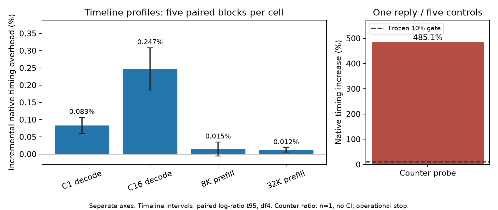

# SelfOptimize G3.0 outcome

[Prospective protocol](../../protocols/selfopt-g3-0/PROTOCOL.md),
[complete result package](final/VERDICT.md), [candidate ledger](ledger-gen3.jsonl),
and [smoke/admission observation](SMOKE.md). The protocol and every amendment
were public before their affected measurements.

G3.0 halted at its counter-profiler validity gate. Both matching champion
controls and all four five-pair timeline cells passed. The exact-ID counter
reply took 5.850585x native control time (n=1 profiled reply versus n=5 controls;
no ratio CI), exceeding the frozen overhead cap. No code candidate executed
and no audited scientific null or speedup is claimed. The replay counters
are retained as diagnostic data, not a candidate bound.

Host readback remains unrun with an inconclusive critical-path bound; EXL3
strips remains unrun behind the invalid counter profile; guard widening has
no eligible remaining path. Their speed intervals are N/A. Every disposition
is retained in the package and ledger.

The valid package is attached in Mission Control, unit complete and product
awaiting review. Final daily restore was 113.972 seconds to health and
115.431 seconds to both routed answers (n=1 cycle). Earlier smoke restoration
is recorded separately. Reservation cost was 1.415772 GPU-hours across two
windows; shared resident fallback busy time was not metered. The preserved
daily and production routes are restored, the other Station and production
router identities are unchanged, and all research claims are released.

These are approved outcome records. No social post, paper, email or upstream
submission was made. The PI decides any publication beyond these records.
