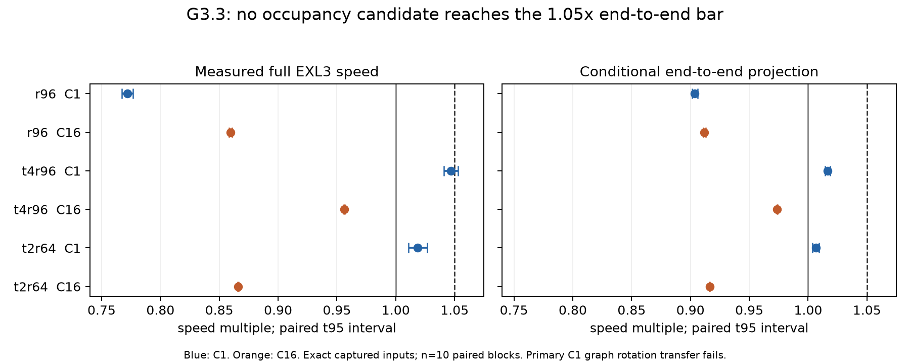

# W28 SelfOptimize G3.3 report

Recorded 2026-11-14T23:19:05.664701-08:00 (PT).

**Three occupancy candidates executed. None reaches the 1.05x end-to-end admission bar; no candidate model run and no new champion.** All six candidate/cell numerical checks pass bitwise. These are measured kernel outcomes, not unrun ceiling dispositions. No audited end-to-end scientific null or production qualification is claimed.

Preregistration: https://github.com/RonanLabsAI/preregistrations/tree/2f3792b/protocols/selfopt-g3-3
Prospective source/payload binding: https://github.com/RonanLabsAI/preregistrations/tree/1b1efb0/protocols/selfopt-g3-3
Native-launch sensitivity amendment: https://github.com/RonanLabsAI/preregistrations/tree/0c074d3/protocols/selfopt-g3-3

## Real capture and harness revalidation

The served champion uses **288 expert-table entries**, not the 256 assumed by G3.2. It calls the per-slot epilogue with null routing weights and combined-output pointers; the family reduces per-slot FP32 outputs outside these six stages. Both differences are now preserved. Checkpoint, binary, recipe and frozen token IDs are unchanged.

Exact early C1/C16 payloads have 8/12 distinct experts. The prospectively fixed middle primary, matching group ordinal 10,732 (42 layers, relative full-width step 256/layer 22), has 8/97. Every completed capture and timeline reply matches frozen IDs. Active checkpoint trellises, scales, routing, normalized activations, scalar arguments and stage outputs stay private; anonymous hashes are in receipts/payload-manifest.json and receipts/primary-payload-manifest.json. The primary is one layer/step, not an exhaustive routing envelope.

The exact champion fatbin reproduces every captured stage output byte for byte. One warm block and five retained blocks of twenty supply stage medians and t95 (df4). Targets remain medians of the five G3.1 served reports; tolerance remains +/-15%. Preparation scrubs 256 MiB, then restores only picks/normalized input from pinned buffers on the same stream, matching their immediate native producers. Weights/scales are not prefetched.

| Cell / stage | Served us | Graph us [t95] | Graph ratio / gate | Native-launch us [t95] | Native ratio / gate |
|---|---:|---|---|---|---|
| C1 group | 3.9040 | 3.6384 [3.620631, 3.656169] | 0.9320 / PASS | 4.0224 [4.004631, 4.040169] | 1.0303 / PASS |
| C1 rotate | 2.5600 | 1.8624 [1.844631, 1.880169] | 0.7275 / FAIL | 2.2304 [2.212631, 2.248169] | 0.8713 / PASS |
| C1 gate/up | 51.5520 | 51.0496 [50.977148, 51.122052] | 0.9903 / PASS | 51.4688 [51.367111, 51.570489] | 0.9984 / PASS |
| C1 epilogue | 4.6080 | 4.0032 [3.994315, 4.012085] | 0.8688 / PASS | 4.5344 [4.488664, 4.580136] | 0.9840 / PASS |
| C1 down | 39.5520 | 39.0944 [39.037165, 39.151635] | 0.9884 / PASS | 39.5104 [39.483746, 39.537054] | 0.9989 / PASS |
| C1 per-slot output | 3.0720 | 2.8992 [2.832714, 2.965686] | 0.9437 / PASS | 3.0528 [3.020156, 3.085444] | 0.9937 / PASS |
| C16 group | 36.7040 | 36.1152 [36.093437, 36.136963] | 0.9840 / PASS | 36.4960 [36.476133, 36.515867] | 0.9943 / PASS |
| C16 rotate | 6.0800 | 5.1840 [5.184000, 5.184000] | 0.8526 / PASS | 5.9584 [5.935749, 5.981051] | 0.9800 / PASS |
| C16 gate/up | 490.3360 | 510.8256 [510.684002, 510.967198] | 1.0418 / PASS | 511.3120 [511.157474, 511.466526] | 1.0428 / PASS |
| C16 epilogue | 5.5360 | 4.8864 [4.868631, 4.904169] | 0.8827 / PASS | 5.3920 [5.299882, 5.484118] | 0.9740 / PASS |
| C16 down | 245.4720 | 256.1056 [256.021783, 256.189417] | 1.0433 / PASS | 256.7040 [256.574485, 256.833515] | 1.0458 / PASS |
| C16 per-slot output | 4.2880 | 3.9392 [3.930315, 3.948085] | 0.9187 / PASS | 4.2208 [4.191333, 4.250267] | 0.9843 / PASS |

Primary graph transfer passes all six C16 stages and five C1 stages; **C1 rotation fails at 0.7275 of served duration**. The separately preregistered native-launch sensitivity passes all twelve stage/cell checks, including C1 rotation at 0.8713. This diagnoses an observable/launch-transfer difference without proving its cause. The failed primary is retained and is not silently replaced. Candidate measurements below retain the original frozen graph A/B design. Intervals describe repeats, not transfer uncertainty.

## Candidate resources and numerics

| Candidate | N columns/CTA | Registers/thread | Static shared bytes | CUDA occupancy API max blocks/SM | Spill stores / loads bytes |
|---|---:|---:|---:|---:|---|
| champion | 128 | 128 | 32832 | 4 | 0 / 0 |
| r96 | 128 | 96 | 32832 | 5 | 380 / 380 |
| t4r96 | 64 | 93 | 16448 | 5 | 0 / 0 |
| t2r64 | 32 | 64 | 8256 | 8 | 0 / 0 |

The blocks column is the CUDA occupancy API maximum on loaded kernels, not achieved occupancy or a fixed-carveout counter. In particular r96 reports five potential blocks, spills and slows.

All keep four warps, the same K splits, MMA accumulation and warp reduction order. All six candidate/cell cases pass finite outputs and five byte-identical repeats of every grouped partial and complete captured six-stage output. The opt-in source compiles for sm103; sm120 compilation emits no experimental kernels. Production symbols/selection and sm120+ behavior are unchanged. These experimental symbols are not integrated or release-qualified; full contracts, edges, nonfinite controls and model gates would be mandatory before serving.

## Kernel A/Bs and empirical bounds

One excluded warm pair, n=10 retained alternating AB/BA block pairs, twenty warm replays per arm/block. CUDA events surround complete graph replay outside capture; Nsight Systems supplies all six node durations. Projection-specific and graph speedups use paired log t95, df9. No pruning or candidate retuning. The empirical conditional projection is B=1/(1-f+f/r), f C1=0.360485 and C16=0.590868; r is measured complete six-stage EXL3 speed. Both interval endpoints are transformed. No occupancy or ideal-deletion ceiling supplies these results.

| Cell / candidate | Gate/up speed [t95] | Down speed [t95] | Full EXL3 speed [t95] | End-to-end projection [transformed interval] | Numerics |
|---|---|---|---|---|---|
| C1 r96 | 0.758267 [0.757549, 0.758985] | 0.672961 [0.672042, 0.673881] | 0.771962 [0.767155, 0.776800] | 0.903761 [0.901377, 0.906142] | BITWISE PASS |
| C1 t4r96 | 0.976563 [0.975404, 0.977723] | 1.198726 [1.196394, 1.201064] | 1.046897 [1.040771, 1.053060] | 1.016413 [1.014324, 1.018500] | BITWISE PASS |
| C1 t2r64 | 0.909086 [0.908020, 0.910153] | 1.244780 [1.242150, 1.247415] | 1.018705 [1.010789, 1.026683] | 1.006663 [1.003863, 1.009457] | BITWISE PASS |
| C16 r96 | 0.862855 [0.862698, 0.863013] | 0.824170 [0.823804, 0.824536] | 0.859523 [0.858156, 0.860893] | 0.911935 [0.911025, 0.912846] | BITWISE PASS |
| C16 t4r96 | 0.943492 [0.943300, 0.943684] | 0.971650 [0.971212, 0.972088] | 0.956314 [0.955836, 0.956792] | 0.973717 [0.973425, 0.974010] | BITWISE PASS |
| C16 t2r64 | 0.842206 [0.842020, 0.842392] | 0.885309 [0.885098, 0.885520] | 0.866122 [0.865692, 0.866553] | 0.916312 [0.916027, 0.916597] | BITWISE PASS |

The best projection is C1 t4r96: 1.016413x, interval [1.014324,1.018500]. Every interval upper is below 1.05. C1 down improves by about 1.20x or 1.24x with smaller tiles, while gate/up slows; every C16 candidate slows both projections. Higher theoretical residency did not deliver the required whole-sequence gain.

These are conditional empirical projections at captured inputs, not observed whole-model speeds. The primary C1 graph transfer failure prevents calling that cell served-applicable under the primary design; C16 passes its complete graph transfer gate. Native-launch sensitivity supplies separate successful stage revalidation at both cells. No candidate clears admission even on its optimistic reported projection. No candidate end-to-end run, fresh five-round champion comparison, prefill comparison or promotion was warranted. The frozen 7c1bc0be champion remains; prior G3.1 rates are prior evidence, not G3.3 measurements.

## Monitor, operations and accounting

Persistent HTTP and NVML sampling use 100 ms monotonic deadlines with a separate 250 ms watchdog and claim heartbeat. Maximum observed completion spacing is 0.150872s, below 0.250s, versus G3.2's 0.326765s. Minimum observed free memory is 31.265625 GiB, above the 16 GiB reserve. Maximum explicit harness allocation is 1,512,850,308 bytes (under 4 GiB). Arrival/read-failure/claim-expiry/stall injections terminate an owned test process in about 1.2 ms after detection; no real production arrival exercised abort, so no scheduler SLA or zero-interference guarantee is claimed.

LEFT total reservation accounting is **0.536436240 GPU-hours**: capture/restoration 0.488009193, primary shared diagnostics 0.030495293, native sensitivity 0.007962094, plus three tiny guarded probes. The eight capture/restoration windows cost 29.28 GPU-minutes, within 40; shared work plus probes is under 30 minutes; candidate full-model phase is zero. Hardware busy-hours are not metered. RIGHT's two already-resident fallback devices were covered by shared claims throughout capture windows; nominal device-claim accounting is 0.976018385 hours, not exclusive reservation or measured busy time.

Last preserved daily restoration: **99.684754s to health; 100.905705s to both routed answers**. Eight manual restores are recorded. Daily container ID/configuration/mounts are preserved, both peers' identities/start times are unchanged, and production router ID/start/configuration hash are unchanged. Shared diagnostics never unloaded the daily. All W28 claims are released.

Six invalid capture-method windows are retained: the first five inherited the wrong expert count and captured nothing; the sixth reached the final stage and failed on optional null buffers. Their restoration and reservation cost are included. A tiny synthetic copy probe and a byte-only early C1 replay are instrumentation checks, not candidate timing samples. Public amendments precede valid dependent samples. ATC board/who coverage was incomplete; this was explicitly directed local PI work, with no upstream issue/PR/public coordination write.

No production LiteLLM restart/reload/config edit, key output, Spark model load, clock change, engine push, other repository push, email or external posting occurred. Only preregistration/outcomes are pushed. Raw traces, payloads, operations and binaries remain private under scratch, anonymously hashed.

## Branches and next step

SelfOptimize feat/w28-g3-3 off fac50d4a: primary implementation b013f84; native-sensitivity implementation ed99e3611ce651043d9e85b5a1ae241db52dfa67. Engine ronanlabs/sm103-enable experiments: 8209d5011828ee6807640eebb9a1a63292667ce6; selected champion remains 7c1bc0be3df413f43c65fb278699b629a44e7a90. Documentation: feat/w7-sm103; report-only handoff heads are supplied separately.

Next: retain the current champion and preregister a candidate that reduces gate/up decoder work. Repeating occupancy-only caps or narrower tiles is not supported by these measured outcomes. Keep the repaired real-payload/native-launch validation and guarded monitor for the next experiment.

Receipts: receipts/results.jsonl, receipts/analysis.json, receipts/native-validation.json, receipts/operations-summary.json, receipts/candidate-ledger.jsonl and anonymous payload/raw hashes.
