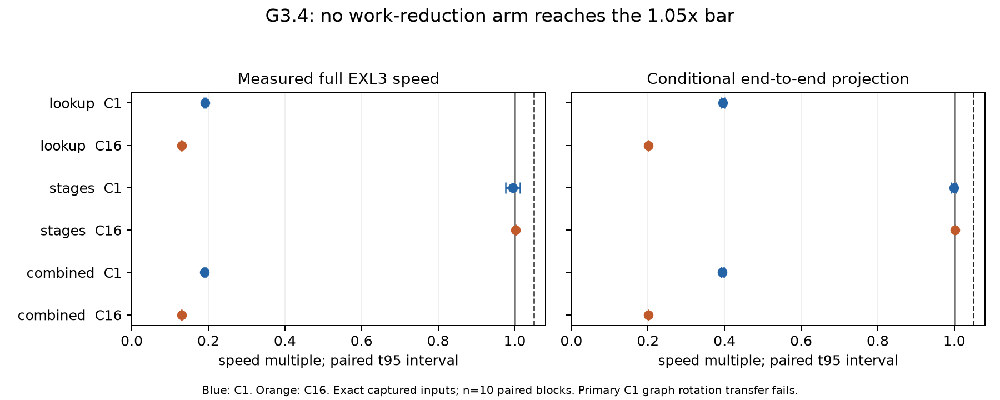

# W29 SelfOptimize G3.4 report

Recorded 2026-11-14T23:35:38.327839-08:00 (PT).

**No candidate qualifies; no end-to-end candidate run and no new champion. The G3 campaign stops for PI review.**

Preregistration: https://github.com/RonanLabsAI/preregistrations/tree/e779267/protocols/selfopt-g3-4
Analysis/binary binding: https://github.com/RonanLabsAI/preregistrations/tree/cba8bac/protocols/selfopt-g3-4

## Candidate results

Exact W28 middle C1/C16 payloads are reused: 288 expert entries, per-slot outputs, 8/97 distinct experts. Every arm/cell passes five bitwise repeats of all grouped partials and all six stage outputs, with finite final outputs. The lookup table checks all 65,536 states in both packed-half positions; table construction is one-time setup outside steady-state timing. Gate/up weights and rotated activations differ between matrices. No weight is shared between gate and up.

One excluded warm pair, ten retained alternating AB/BA pairs, twenty replays per arm/block, paired-log t95 df9; no pruning. Complete EXL3 speed includes all six stages and graph replay overhead. Conditional Amdahl projection uses f_C1=0.360485 and f_C16=0.590868 with unchanged other work. Both interval endpoints are transformed; these are captured-input projections, not whole-model observations.

| Cell / arm | Gate/up kernel speed [t95] | Complete EXL3 speed [t95] | End-to-end projection [t95 transform] | Numerics |
|---|---|---|---|---|
| C1 lookup | 0.094750 [0.094644, 0.094857] | 0.190726 [0.188183, 0.193303] | 0.395322 [0.391371, 0.399300] | BITWISE PASS |
| C1 stages | 0.999436 [0.998554, 1.000319] | 0.994649 [0.976333, 1.013308] | 0.998064 [0.991337, 1.004757] | BITWISE PASS |
| C1 combined | 0.094623 [0.094484, 0.094762] | 0.190083 [0.187720, 0.192476] | 0.394325 [0.390648, 0.398026] | BITWISE PASS |
| C16 lookup | 0.083899 [0.083849, 0.083950] | 0.129696 [0.129603, 0.129788] | 0.201412 [0.201281, 0.201544] | BITWISE PASS |
| C16 stages | 0.999941 [0.999719, 1.000162] | 1.002237 [1.001590, 1.002884] | 1.001320 [1.000939, 1.001702] | BITWISE PASS |
| C16 combined | 0.083896 [0.083847, 0.083945] | 0.129734 [0.129650, 0.129817] | 0.201467 [0.201347, 0.201586] | BITWISE PASS |

The lookup arm reduces repeated codebook arithmetic by replacing it with indexed half-value loads, but greatly increases measured gate/up duration. Loaded resources are 128 registers/thread, 32,832 shared bytes, four maximum resident blocks/SM; compiler reports 32 spill-store and 40 spill-load bytes. The 128 KiB table plus a 128 KiB validation buffer are retained in the allocation accounting. Cache/load latency and spills are possible explanations; no new counter attribution was collected. This result rules out this implementation on these payloads, not every lookup or decoder redesign.

The stages arm pairs input rotations while preserving separate scales and butterfly order, and removes the unused shared reduction buffer from the captured per-slot down epilogue. Rotation uses 28 registers versus champion 21; slot epilogue uses 48 and zero static shared bytes versus champion 48 and 16,384 shared bytes. Stage-specific ratios for all six stages are in receipts/analysis.json. Whole-sequence benefit is negligible. The combined arm retains the lookup slowdown. No candidate was retuned after observing timing.

## Transfer and applicability

The prospectively selected native-launch primary passes all twelve stage/cell checks within the unchanged +/-15% served-duration tolerance. The separately retained graph sensitivity passes C16 but fails C1 rotation again (0.729 of served time). C1 graph A/Bs therefore remain diagnostic; the native validation does not silently replace that graph result. Even every optimistic conditional projection upper is below 1.05, so transfer uncertainty does not admit any arm. Intervals describe repeat precision, not transfer uncertainty.

| Cell / stage | Served us | Native us [t95] | Ratio | Gate |
|---|---:|---|---:|---|
| C1 0 | 3.9040 | 4.0160 [3.971577, 4.060423] | 1.0287 | PASS |
| C1 1 | 2.5600 | 2.2400 [2.211904, 2.268096] | 0.8750 | PASS |
| C1 2 | 51.5520 | 51.4400 [51.333015, 51.546985] | 0.9978 | PASS |
| C1 3 | 4.6080 | 4.4928 [4.454586, 4.531014] | 0.9750 | PASS |
| C1 4 | 39.5520 | 39.5104 [39.440725, 39.580075] | 0.9989 | PASS |
| C1 5 | 3.0720 | 3.0336 [2.971408, 3.095792] | 0.9875 | PASS |
| C16 0 | 36.7040 | 36.4768 [36.447333, 36.506267] | 0.9938 | PASS |
| C16 1 | 6.0800 | 5.9584 [5.928271, 5.988529] | 0.9800 | PASS |
| C16 2 | 490.3360 | 510.9344 [510.870641, 510.998159] | 1.0420 | PASS |
| C16 3 | 5.5360 | 5.4016 [5.344365, 5.458835] | 0.9757 | PASS |
| C16 4 | 245.4720 | 256.7456 [256.598533, 256.892667] | 1.0459 | PASS |
| C16 5 | 4.2880 | 4.2016 [4.183831, 4.219369] | 0.9799 | PASS |

Further expert batching is structurally unrun: the existing grouped kernel already shares each decoded expert tile across sixteen members. The actual C16 membership histogram is 74 singletons, 16 doubles, six triples and one quadruple (128 slots, 97 experts). Every expert fits one member tile, so rebatching cannot remove a duplicated decoder pass here. A single gate/up weight decode is inapplicable because the matrices have different weights; only the common unrotated activation can be loaded once, as tested by the stages arm. These are unrun dispositions, not measured scientific nulls.

## Model decision and operations

The admission rule requires projected interval lower >1.05 at an applicable cell. None qualifies. Full model contracts, fresh champion measurement, candidate token-ID/model comparison and prefill gates are unrun; no audited end-to-end null is claimed. Champion remains 7c1bc0be. Prior G3.1 champion measurements (C1 81.783164 and C16 272.650814 tok/s) are historical, not G3.4 remeasurements.

LEFT shared reservation: **0.038622297 GPU-hours** (2.317338 GPU-minutes), ten guarded cases, no exclusive or fallback reservation. Hardware busy-hours were not metered. Maximum explicit allocation 1,513,112,452 bytes; minimum observed free 31.265625 GiB; maximum completion gap 0.151802s, below 0.250s. Injected failures stop owned processes about 1.1 ms after detection. No real arrival occurred, so no scheduler SLA or zero-interference claim.

**Restore time: N/A; daily never stopped or reloaded.** Daily and both peer container identities, starts, configuration and mounts are unchanged; daily health passes. Production router identity, start and configuration hash are unchanged; all W29 claims are released. No production LiteLLM action, key output, Spark model load, clock change or non-preregistration push occurred.

Compile sm103 passes; sm120 emits no experimental kernels. New engine files add zero lean findings to the inherited 341-problem baseline; diff whitespace and Python compile checks pass. Full engine/model contracts are explicitly unrun because these are opt-in unselected diagnostics and no candidate admits serving. ATC board/who coverage is incomplete (limits and unavailable PR files); no upstream issue/PR/coordination write or clearance is claimed. This is explicitly authorized local PI work.

Operational deviation: Nsight logged transient default system-temporary staging; retained traces, databases and all large final outputs are in scratch. No staging files are published. CPU-only setup failures are retained in receipts/results.jsonl. No invalid GPU candidate attempts occurred. Private raw captures, traces and infrastructure snapshots remain in scratch, with anonymous hashes only in this package.

## Branches and campaign recommendation

Engine ronanlabs/sm103-enable: a64baaacc3a1524bc2a5cb728503cf67ab0e5dea. SelfOptimize feat/w29-g3-4 off 42bdb25: implementation 8e0555713100104c824554ad51870b2a3e01c7d2; final report-only heads are supplied at handoff. Docs feat/w7-sm103. Only preregistration/outcomes are pushed.

See CAMPAIGN-SUMMARY-G3.md for the final campaign assessment. Stop here for PI review; do not start G3.5.

Receipts: receipts/results.jsonl, receipts/analysis.json, receipts/operations-summary.json, receipts/candidate-ledger.jsonl and anonymous payload/raw hashes.
